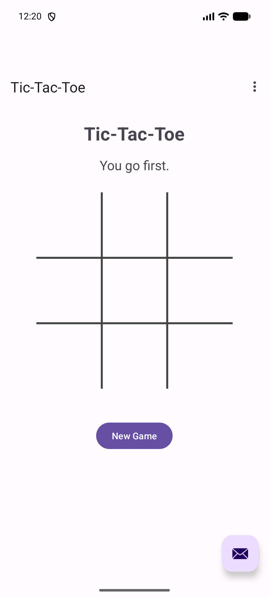
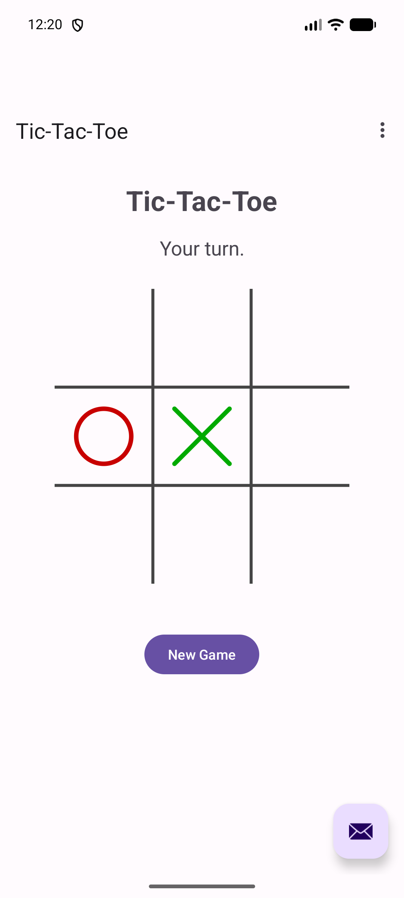
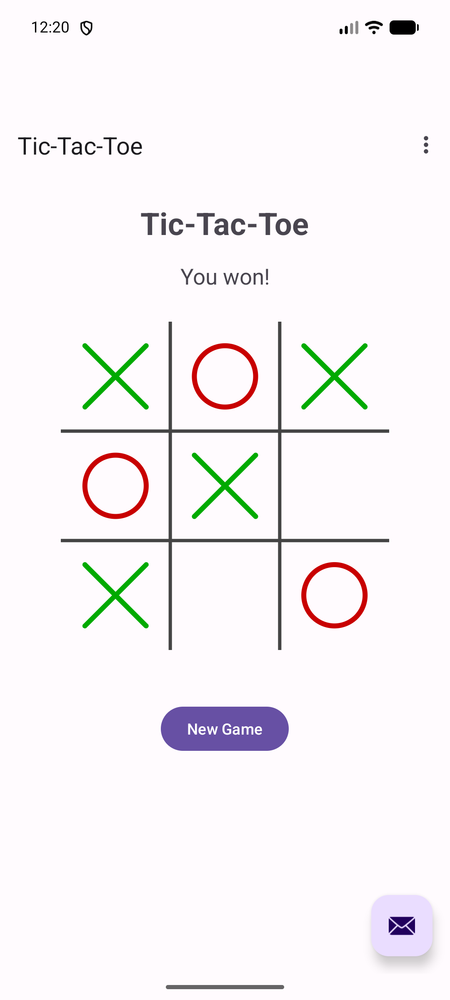
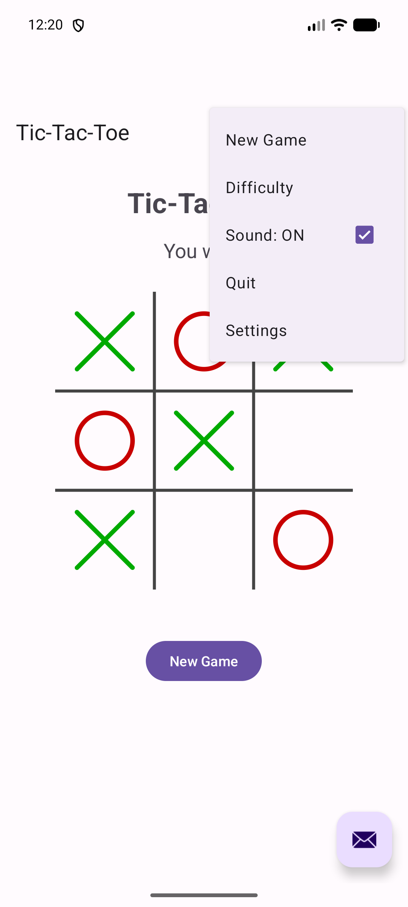
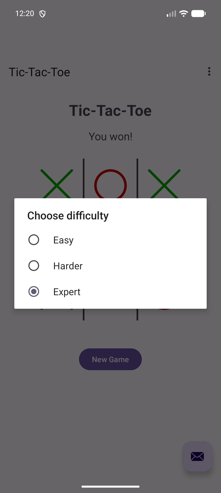

# ❌⭕ Reto 5 – Tic-Tac-Toe con Canvas, IA y efectos de sonido

> **Curso:** Desarrollo de Aplicaciones para Dispositivos Móviles · Universidad Nacional de Colombia
> **Autor y desarrollador:** Luis Alberto Castillo Sanabria
> **Plataforma:** Android (Kotlin + vista personalizada con Canvas)

En este reto el tablero deja de ser una cuadrícula de botones y pasa a **dibujarse a mano con `Canvas`** en una vista personalizada (`BoardView`). También se agregan **efectos de sonido** para cada jugada y una opción del menú para activarlos o silenciarlos.

| Inicio | Tablero dibujado con Canvas | Partida terminada |
|:---:|:---:|:---:|
|  |  |  |

| Menú con opción de sonido | Dificultad |
|:---:|:---:|
|  |  |

## Funcionalidades

- **`BoardView`**: vista propia que dibuja la cuadrícula, las X y las O con `Canvas` y `Paint`.
- Detección del toque con `onTouchEvent` para saber qué casilla eligió el jugador.
- **Sonidos** distintos para la jugada del jugador y la de Android (`MediaPlayer`).
- Android "piensa" 1 segundo antes de responder, para que la partida se sienta natural.
- Menú: **New Game**, **Difficulty**, **Sound: ON/OFF** y **Quit**.
- Tres niveles de dificultad: Easy, Harder y Expert.

## Documentación

📘 **[Manual de usuario y técnico](docs/MANUAL.md)**

## Tecnologías

Kotlin · Vista personalizada (`View` + `Canvas`) · `MediaPlayer` · Fragments · View Binding · minSdk 24

## Cómo ejecutarlo

1. `git clone https://github.com/LCastillo9806/Reto05-TicTacToe-Canvas.git`
2. Abrir en **Android Studio** y pulsar **Run ▶**.

## Autoría

Desarrollado por **Luis Alberto Castillo Sanabria** ([@LCastillo9806](https://github.com/LCastillo9806)) — Universidad Nacional de Colombia.
