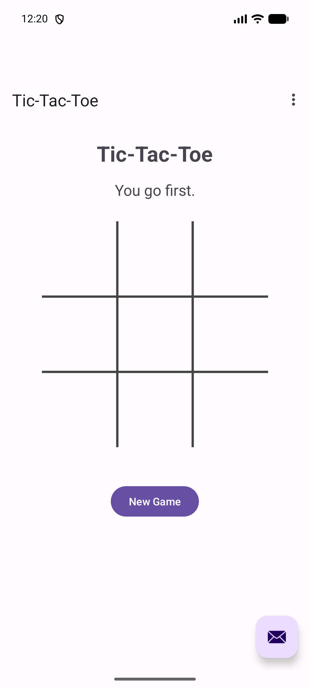
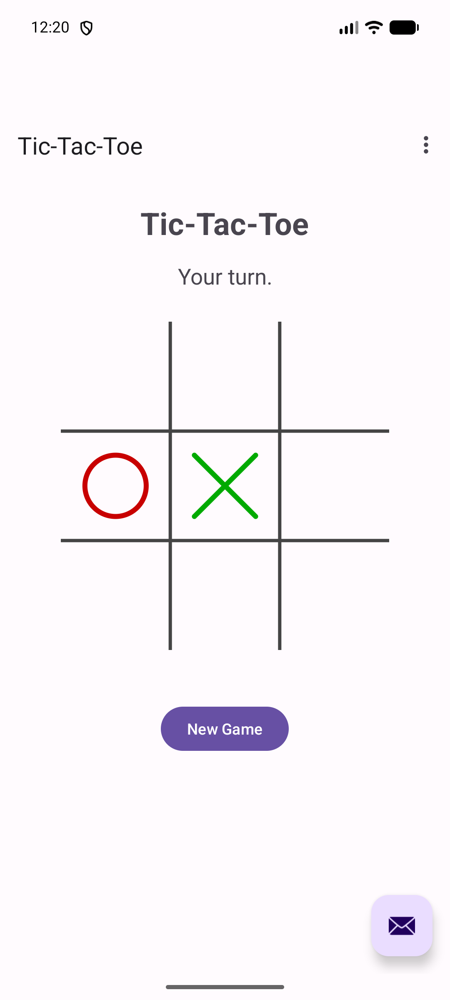
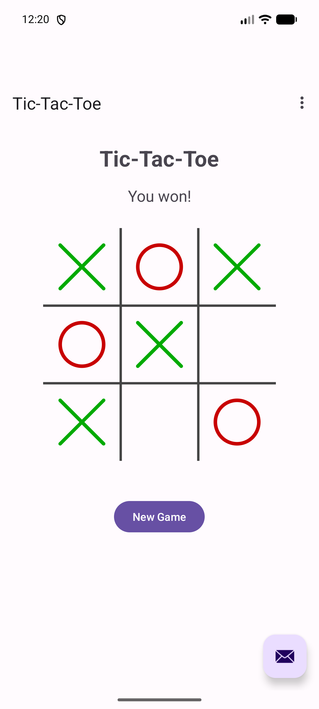
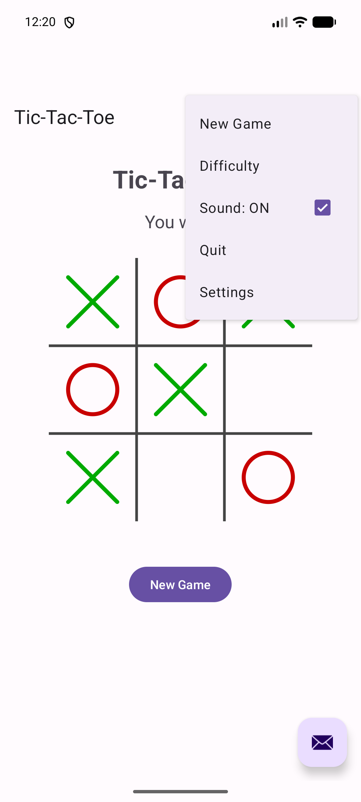
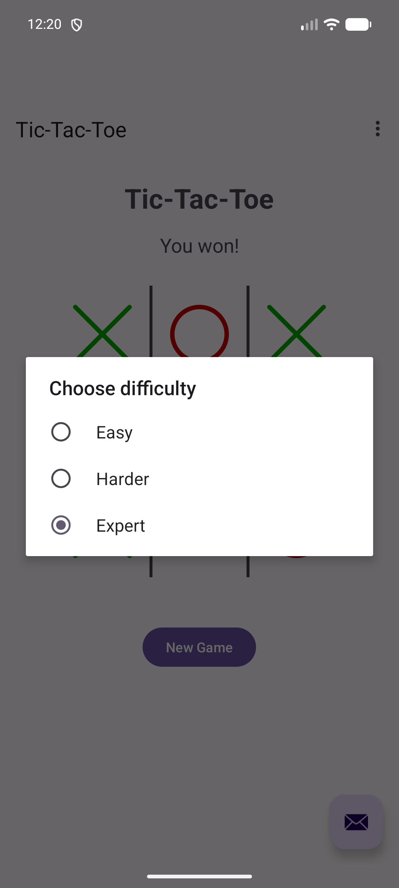

# ❌⭕ Manual de Usuario y Técnico — Reto 5: Canvas, IA y efectos de sonido

> **Curso:** Desarrollo de Aplicaciones para Dispositivos Móviles
> **Autor y desarrollador:** Luis Alberto Castillo Sanabria
> **Institución:** Universidad Nacional de Colombia
> **Plataforma:** Android · Kotlin · Canvas · MediaPlayer

---

## 📑 Tabla de contenidos

1. [Propósito](#1-propósito)
2. [Autoría](#2-autoría)
3. [Manual de uso](#3-manual-de-uso)
4. [El tablero con Canvas](#4-el-tablero-con-canvas)
5. [Efectos de sonido](#5-efectos-de-sonido)
6. [Arquitectura y código](#6-arquitectura-y-código)
7. [Compilación y ejecución](#7-compilación-y-ejecución)

---

## 1. Propósito

Pasar de una interfaz hecha con botones a una **interfaz dibujada**. El tablero es una vista personalizada que pinta la cuadrícula y las fichas con la API de **Canvas** de Android, y reacciona a los toques del usuario. Además se incorporan **efectos de sonido** con `MediaPlayer`.

## 2. Autoría

| Integrante | Rol |
|:---|:---|
| **Luis Alberto Castillo Sanabria** | Autor y desarrollador |

Curso *Desarrollo de Aplicaciones para Dispositivos Móviles* — **Universidad Nacional de Colombia**.
Repositorio: <https://github.com/LCastillo9806/Reto05-TicTacToe-Canvas>

## 3. Manual de uso

### 3.1 Pantalla inicial

El tablero aparece como una cuadrícula de líneas dibujadas. El mensaje **"You go first."** indica que empieza el jugador.

| Pantalla inicial |
|:---:|
|  |

### 3.2 Jugar

1. Toca cualquier casilla libre del tablero: se dibuja una **X verde** y suena el efecto de tu jugada.
2. Android espera **1 segundo** ("está pensando"), dibuja una **O roja** y suena su efecto.
3. Mientras Android piensa, el tablero no acepta toques.

| Primera jugada |
|:---:|
|  |

### 3.3 Resultado

Cuando alguien hace tres en línea o el tablero se llena, el mensaje muestra **You won!**, **Android won!** o **It's a tie!**, y el tablero se bloquea hasta pulsar **New Game**.

| Partida ganada por el jugador (diagonal) |
|:---:|
|  |

### 3.4 Menú de opciones y sonido

Toca **⋮** en la barra superior:

| Opción | Acción |
|---|---|
| **New Game** | Reinicia el tablero |
| **Difficulty** | Elegir Easy, Harder o Expert |
| **Sound: ON / OFF** | Activa o silencia los efectos de sonido; el texto cambia según el estado |
| **Quit** | Confirma y cierra la app |

| Menú de opciones | Diálogo de dificultad |
|:---:|:---:|
|  |  |

## 4. El tablero con Canvas

`BoardView` es una clase que extiende `View` y sobrescribe `onDraw(canvas)`:

1. **Cuadrícula:** 4 líneas (`drawLine`) que dividen el área en 3 × 3 celdas.
2. **X:** dos líneas cruzadas con un `Paint` verde.
3. **O:** un círculo (`drawCircle`) con un `Paint` rojo de solo contorno.

Cada vez que cambia el tablero se llama a `invalidate()` y Android vuelve a ejecutar `onDraw`.

Para saber qué casilla se tocó, la vista convierte las coordenadas del dedo en fila y columna:

```kotlin
val col = (event.x / cellWidth).toInt()
val row = (event.y / cellHeight).toInt()
val position = row * 3 + col      // 0..8
```

*(Esquema simplificado del cálculo que hace `BoardView`.)*

## 5. Efectos de sonido

- Los archivos están en `app/src/main/res/raw/`: `human_move.mp3` y `computer_move.mp3`.
- Se usa **un solo `MediaPlayer`** a la vez: antes de reproducir un sonido se libera el anterior, y al terminar se libera de nuevo para no gastar memoria.
- Si el usuario elige **Sound: OFF**, `playSound()` no reproduce nada.
- Al destruir la vista (`onDestroyView`) se detiene y libera el reproductor.

## 6. Arquitectura y código

```
FirstFragment (pantalla del juego)
 ├─ BoardView  (Canvas)  ── onDraw() / onTouchEvent() → posición 0..8
 ├─ TicTacToeGame        ── tablero, ganador, IA por niveles
 ├─ MediaPlayer          ── human_move.mp3 / computer_move.mp3
 └─ MenuProvider         ── New Game · Difficulty · Sound · Quit
```

| Archivo | Función |
|---|---|
| `app/src/main/java/co/edu/unal/tictactoe/BoardView.kt` | Vista personalizada: dibuja el tablero y detecta toques |
| `app/src/main/java/co/edu/unal/tictactoe/FirstFragment.kt` | Turnos, retardo de Android, sonido, menú y diálogos |
| `app/src/main/java/co/edu/unal/tictactoe/TicTacToeGame.kt` | Lógica del juego e IA (Easy / Harder / Expert) |
| `app/src/main/res/raw/` | Efectos de sonido |
| `app/src/main/res/menu/options_menu.xml` | Opciones del menú |

## 7. Compilación y ejecución

```bash
git clone https://github.com/LCastillo9806/Reto05-TicTacToe-Canvas.git
cd Reto05-TicTacToe-Canvas
./gradlew installDebug
```

O bien: abrir el proyecto en **Android Studio** y pulsar **Run ▶**. Para oír los efectos, sube el volumen multimedia del dispositivo.

---
*Luis Alberto Castillo Sanabria — Universidad Nacional de Colombia*
